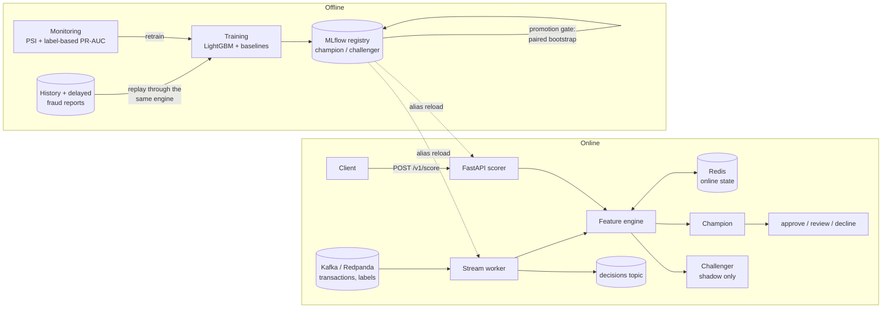

# fraudwatch-rt

[](https://github.com/bharat-sing-h/fraudwatch-rt/actions/workflows/ci.yml)


**Real-time card-fraud detection, covering the whole ML lifecycle:** streaming features with point-in-time-correct training data, LightGBM with an MLflow model registry, millisecond scoring over HTTP and Kafka, shadow deployment, drift monitoring and statistically gated promotion.



## Results

All numbers below are **measured** by the code in this repo (`fw train`, `fw experiment`, `fw benchmark`) on **simulated** transactions: 570k–760k transactions, ~1% fraud, 4 fraud patterns plus a drift scenario (see [simulator](src/fraudwatch/simulate.py)). They show the system works and how its parts interact. They are not a claim about any real bank's data.

### Model quality (held-out last 20 days, strict time split)

| Model | PR-AUC [95% CI] | Recall | Precision | Alert rate | Fraud $ caught |
|---|---|---|---|---|---|
| Hand-written rules | 0.198 [0.179, 0.217] | 30.1% | 53.5% | 0.61% | 54.6% |
| Logistic regression | 0.570 [0.547, 0.592] | 63.0% | 39.6% | 1.72% | 85.6% |
| **LightGBM** | **0.698** [0.672, 0.724] | **79.5%** | 38.2% | 2.25% | **91.3%** |

LightGBM vs. logistic regression: **+0.129 PR-AUC, 95% CI [+0.112, +0.142]** (paired day-block bootstrap). Thresholds are chosen on validation data to maximise fraud dollars caught minus $5 per analyst review. Full card: [docs/results/model_card.md](docs/results/model_card.md).

### Drift → detection → retrain → shadow → promotion

A new fraud pattern (night-time online fraud with normal amounts) starts on day 80:

| | Week before drift | Weeks 3–5 after drift |
|---|---|---|
| Champion PR-AUC (on reported labels) | 0.708 | 0.563 |
| Largest feature PSI | 0.001 | ≤ 0.038 |

**Input-drift monitors stay green while performance drops.** The new fraud is a tiny share of traffic, so only label-based monitoring catches it. A challenger retrained on day 105 runs in shadow on the same traffic:

| Shadow period (days 105–119) | PR-AUC [95% CI] | Recall on the new pattern |
|---|---|---|
| v1 champion | 0.586 [0.562, 0.611] | 3.9% |
| v2 challenger | **0.760** [0.738, 0.783] | **96.8%** |

The gate promotes v2 (Δ +0.174, CI [+0.161, +0.190]). The registry moves `champion` to v2 and keeps v1 as `previous` for one-command rollback. Full report: [docs/results/drift_experiment.md](docs/results/drift_experiment.md).

### Latency (4-core x86 VM, single client, 5,000 requests after warming 28 days of state)

| Path | p50 | p99 |
|---|---|---|
| Features + model, in-process, Redis store | 1.54 ms | 2.93 ms |
| **Full HTTP round trip, Redis store** | **3.79 ms** | **5.74 ms** |
| Features + model, in-process, in-memory store | 0.07 ms | 0.15 ms |

Model inference itself takes about 20 µs; the rest is Redis round trips (see [design notes](docs/design.md#latency) for the next optimisation). Full table: [docs/results/latency.md](docs/results/latency.md).

## Quickstart

```bash
git clone https://github.com/bharat-sing-h/fraudwatch-rt && cd fraudwatch-rt
pip install -e ".[dev,kafka]"

fw simulate --data data --days 90            # customers, terminals, 570k transactions
fw features --data data                      # point-in-time features (replay, ~20 s)
fw train --data data --alias champion --out models/champion   # + MLflow run & registry
fw experiment --out reports                  # the full drift/retrain/promotion story (~90 s)
fw benchmark --data data --model-dir models/champion
FW_MODEL_DIR=models/champion fw serve        # http://localhost:8080/docs
```

**Whole system in Docker** (Redpanda, Redis, MLflow, bootstrap training, API, stream worker, Prometheus, Grafana):

```bash
docker compose -f deploy/docker-compose.yml up -d --build
docker compose -f deploy/docker-compose.yml run --rm replay   # stream traffic + fraud reports through Kafka
```

CI runs exactly this: it starts the stack, scores over HTTP, and pushes 3,000 events through Kafka.

## What's inside

| Component | Key ideas |
|---|---|
| **[Simulator](src/fraudwatch/simulate.py)** | Customers, terminals, spending profiles; compromised terminals, account takeover, card testing and impossible travel, each with a different detectable signature; **fraud reports arrive days later** |
| **[Feature engine](src/fraudwatch/features/engine.py)** | **One implementation** for training and serving: velocity windows, amount z-scores, distance and implied speed, terminal risk from reported fraud. Training data is produced by *replaying* history through it, so it's **point-in-time correct by construction**. Tested: Redis-backed online features equal offline features exactly, and removing future data doesn't change any past feature |
| **[Online store](src/fraudwatch/features/store.py)** | Redis sorted-set time windows (append-only, so concurrent writers need no locks) and per-card hashes; deduplication so Kafka redeliveries don't double-count |
| **[Training](src/fraudwatch/model/train.py)** | Strict time splits with a label-maturity gap; trains only on fraud **already reported** at training time; rules and logistic-regression baselines; cost-optimal thresholds; day-block bootstrap CIs |
| **[Registry](src/fraudwatch/model/registry.py)** | MLflow runs, model versions and **aliases** (`champion`, `challenger`, `previous`). Promotion and rollback move an alias; serving hot-reloads with no redeploy |
| **[Scoring](src/fraudwatch/serve)** | FastAPI and a Kafka worker share one `Scorer`; challenger scored **in shadow**; Prometheus metrics for latency per stage, decisions, score distribution and shadow disagreements |
| **[Stream worker](src/fraudwatch/stream/worker.py)** | At-least-once delivery: decisions are flushed before offsets are committed; tested by crashing mid-batch and redelivering |
| **[Monitoring](src/fraudwatch/monitor)** | PSI per feature and on the score, against reference distributions stored *with the model*; PR-AUC on reported labels; promotion gate on a paired bootstrap of the PR-AUC difference |

## CLI

`fw simulate | features | train | promote | rollback | monitor | experiment | benchmark | serve | stream | replay | load-profiles`

## Development

```bash
pip install -e ".[dev,kafka]"
pytest --cov              # 33 tests, 96% coverage (includes Redis-vs-batch parity and leakage tests)
ruff check src tests && mypy
```

Design decisions and trade-offs: [docs/design.md](docs/design.md).

## License
MIT
